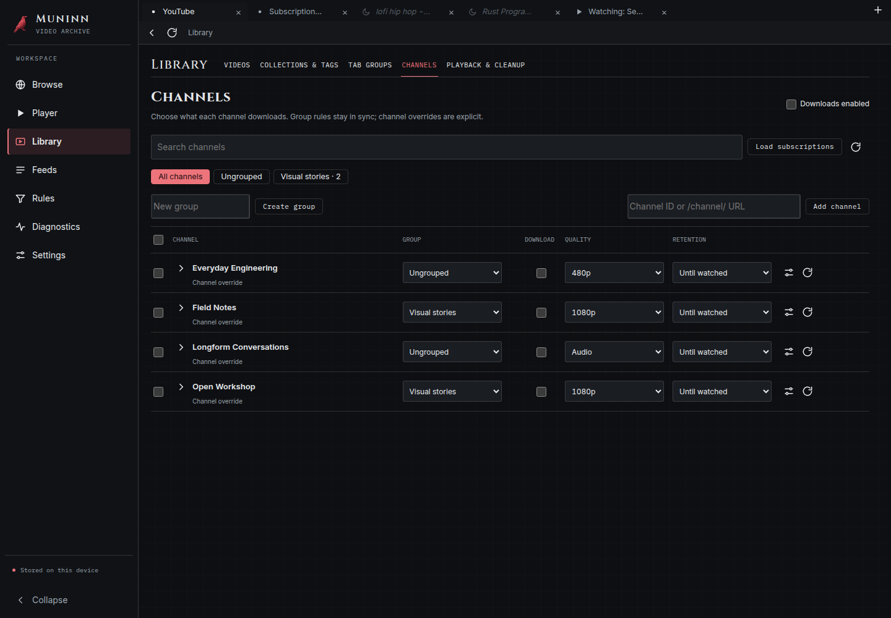

# Muninn

Odin's raven of memory. A **disk-backed, local-first YouTube browser for macOS**.
Browse YouTube in native webviews, play videos in Muninn's own player, and manage
cached media, channel policies, collections and tags through the app or CLI.

**Experimental preview.** Local playback on macOS still has unresolved reports.
Read [known issues](docs/KNOWN_ISSUES.md) before installing. A successful CI build does not imply
a supported release.



*Interface preview with synthetic channel data. Browser-hosted UI with a mocked
native shell and real local core; this is not a macOS playback verification.*

* You browse the real YouTube (home, subscriptions, search, channels) in tabs, signed into your
  own Google account.
* **Videos never play in YouTube's player.** Opening a video (a thumbnail, a link, a typed URL)
  opens a dedicated player tab: Muninn's player, title, channel, description,
  comments and related videos. It is designed to **cache the video to disk while
  you watch**, then reuse local media on subsequent playback.
* **Many tabs, bounded RAM.** Background tabs hibernate: their web view (and its web content
  process) is destroyed; URL, scroll position and the video's playback time are kept in SQLite and
  a sleeping tab is restored from cached feeds, metadata and comments.
* **Three separate caches** (video on disk, content in SQLite, browsing state in SQLite), each
  with its own retention, TTLs, rules engine, eviction and disk caps. Rules prefetch at 360p,
  480p or audio-only and can promote entries to a protected library.

Status: **v0.2.13 development preview.** Built and tested on Linux (the real app runs under xvfb with WebKitGTK),
cross-compiled, ad-hoc signed and structure-verified for macOS. This build has **not been launched
here on a Mac** (see [What is untested](#what-is-untested)).

## Install on the Mac

Requires **macOS 14 (Sonoma) or newer**.

1. Download `Muninn_<version>_macos-arm64.zip` (Apple Silicon) from the
   [GitHub releases](https://github.com/iarnvidr/muninn/releases) when a standalone
   prerelease is available, and check it with
   `shasum -a 256 -c Muninn_<version>_macos-arm64.zip.sha256`.
2. Unzip, and move `Muninn.app` to `/Applications`.
3. The app is **ad-hoc signed, not notarized**, so Gatekeeper blocks the first launch. Once:
   right-click the app, choose **Open**, confirm; or run
   `xattr -dr com.apple.quarantine /Applications/Muninn.app`.

Then open Muninn and browse YouTube. Sign-in has been reported working on the user's
Mac. Google may still reject some embedded-browser login flows. Configured public
channel downloads do not require a Google login.

The first launch may show a macOS dialog asking you to allow Muninn's local certificate
(see [How capture works](#how-capture-works)).

## Using it

* **Outside links**: other apps can open a YouTube URL with `open -a Muninn URL`
  or a `muninn://open?url=...` app link. See [app links](docs/APP_LINKS.md) for
  encoding, validation and native verification limits.

* **Library views**: switch between **Browse** (thumbnail grid and search-result rows)
  and **Manage** (storage meters and every individual copy). Browse searches your
  local library when you press Enter or the search button; collections, tags and
  state filters work in both views. Your view choice is remembered. See
  [Library views](docs/LIBRARY_VIEWS.md).
* **Large browser imports**: `muninn --cli import links FILE --collection NAME` puts
  URLs in Library without opening tabs or downloading media. The CLI reference
  explains preview, JSON titles and removing links.
* **Channels**: Library → Channels uses the full page. Create channel groups with
  shared quality (including 1080p), retention and polling rules, or override a channel.
  Expand a channel inline to see **In Muninn** copies or page through **Channel videos**
  and play/download individual uploads. See [verification and limits](docs/VERIFY_0.2.6.md).
* **Automation and CLI**: [CLI and policy reference](docs/CLI.md) covers retention,
  channel downloads, importing media and tabs, and persistent logs. These changes
  require a build containing the CLI; the earlier 0.2.0 test artifact does not have it.

* **Tabs**: new tab, close, back/forward/reload, an address/search box (a URL opens it; words
  search YouTube). Cmd+T / Cmd+W / Cmd+L / Cmd+R.
* **Sidebar**: Browse, Player, Library, Feeds, Rules, Settings are pages (Diagnostics appears after turning on Developer mode in Settings) of the same window.
  Browse returns to a YouTube tab; Player returns to the current video. Library Play creates a new
  player tab. Drag tabs to group labels or before another tab; Library → Tab groups supports the
  same moves, with dropdowns as a keyboard alternative.
* **Sponsored cards**: YouTube browse ad containers are hidden, including after
  navigation and scrolling. Their nested video renderers are excluded from newly
  captured feeds. This does not skip sponsorship segments within creators' videos.
* **Keep reminder**: the timeline marks your watched/cleanup threshold (95% by
  default). Reaching it shows a small **Keep** prompt inside the video frame;
  Keep protects the playing copy, and dismissing leaves the cleanup policy in place.
  Protected copies and keep rules do not show the reminder. See
  [player keep point](docs/PLAYER_KEEP_POINT.md).
* **Watch view**: the player (seek, speed, volume), the cache panel (cache at 360p/480p/720p or
  audio-only, save to the library), comments (load more on demand), related videos. Back returns
  to the YouTube page exactly where you left it. Leaving the player keeps it in the sidebar mini-player;
  floating PiP follows the policy in Settings. Settings save automatically as you change them.
* **Sign-in**: sign in on YouTube in the tab. If Google ever refuses the in-tab flow, Settings has
  **Sign in in a separate window** (same login store).
* **Hibernation** (Settings): how many tabs stay warm (default 3) and how long a background tab
  must be idle before it sleeps (default 2 minutes). A sleeping tab shows from cache instantly and
  loads the live page when you click it.

## Architecture

```
 Muninn.app  (one process tree; the Rust core runs inside the app)
 ┌──────────────────────────────────────────────────────────────────────────────────────┐
 │ window                                                                               │
 │  ├ chrome web view: Muninn's UI (tab strip, address bar, watch view, Library, ...)   │
 │  │     served by the in-process server at 127.0.0.1, auto-generated token per launch│
 │  └ one native web view per LIVE YouTube tab, laid over the chrome's content area     │
 │       - own data store (login), proxy = Muninn's capture proxy, clean Safari UA      │
 │       - page script: video links -> Muninn's player, URL/scroll reports              │
 │                                                                                      │
 │ muninn-core (Rust)                                                                   │
 │  ├ capture proxy 127.0.0.1:<random>   HTTP CONNECT; decrypts *.youtube.com only     │
 │  │     tees youtubei/v1 + page HTML into the content cache while they stream;        │
 │  │     REFUSES *.googlevideo.com (YouTube's player downloads nothing); tunnels the   │
 │  │     rest untouched, including Google sign-in                                      │
 │  ├ (a) video cache   cache/ + library/     (b) content cache   (c) browsing state    │
 │  ├ rules engine, eviction, scheduler, yt-dlp download worker                         │
 │  ├ play-while-caching pipeline: yt-dlp resolves, ffmpeg writes HLS + final mp4       │
 │  └ watch data: metadata, related videos and comment pages from YouTube's own API     │
 │ bundled in Contents/Resources/bin: yt-dlp, ffmpeg, deno                              │
 └──────────────────────────────────────────────────────────────────────────────────────┘
```

* **`core/`** (`muninn-core`): plain Rust library with all the logic, so it builds and tests on
  Linux. `muninn-service` is a headless binary around it.
* **`src-tauri/`**: the Tauri 2 shell (tabs, native web views, hibernation, certificate trust,
  commands) and `inject.js`, the page script for the YouTube tabs.
* **`ui/`**: Muninn's own UI (plain HTML/JS/CSS), embedded in the binary.
* **`build/`**: cross-compiles, bundles, signs and verifies the macOS app on a Linux Docker host.
* **`e2e/`**: the driver for the Linux/xvfb end-to-end run of the real app.

### Three independent caches

| Cache | Where | Contents | Retention |
|---|---|---|---|
| (a) Video | `cache/video/` (evictable) and `library/` (never evicted); index in `db/video.sqlite` | video/audio files keyed `<videoId>.<audio\|360\|480\|720>` | per-rule retention days, LRU eviction under the disk caps |
| (b) Content | `db/content.sqlite` | metadata (+ related videos), comments, search results, thumbnails, feed snapshots, watch progress; zlib-compressed JSON | titles/descriptions/thumbnails 21 days; first comments 24 h; search 2 h; progress persistent; **every** feed snapshot is kept (30 days, 500 per kind) |
| (c) Browsing | `db/browsing.sqlite` | tab URLs, history, scroll position, selected video and playback time | tiny; history capped at 5000 rows |

Data lives under `~/Library/Application Support/io.github.iarnvidr.muninn/` (`cache/`, `library/`,
`db/`, `bin/`, `ca/`). Bundle id `io.github.iarnvidr.muninn`.

### How capture works

WKWebView cannot intercept https, so each YouTube web view is pointed at an HTTP CONNECT proxy
inside the app (`WebviewBuilder::proxy_url`, which is why macOS 14 is the minimum). The proxy:

* **Decrypts only `*.youtube.com`** (not `accounts.youtube.com`, not `accounts.google.com`: Google
  sign-in is never touched) with certificates from a **per-install CA** generated on first run.
  The CA is name-constrained to `youtube.com`/`ytimg.com`, its key stays in `ca/` (mode 0600), and
  it is trusted for TLS server auth only.
* **Copies `youtubei/v1/browse|next|search|player` and the page HTML to the content cache while
  they stream to the page.** The page never waits for the copy; parsing runs on another thread
  and any failure is dropped silently.
* **Refuses `*.googlevideo.com`.** Video plays only in Muninn's player, so YouTube's player
  downloads and decodes nothing (saves RAM and bandwidth). Diagnostics shows
  `media_bytes_fetched`, which stays 0.

**Trust.** Order of mechanisms: (1) the app answers WebKit's server-trust challenge for chains
that end in Muninn's CA (wry's navigation delegate has no such method, so it is added through
the Objective-C runtime; `src-tauri/src/trust_mac.rs`); (2) if the proxy sees clients rejecting
the certificate anyway, the app adds the CA to the *login keychain with user-scope, SSL-only
trust* (`security add-trusted-cert`), which costs the one macOS confirmation prompt. On Linux
(development builds) the exact leaf certificates are approved with WebKitGTK's
`allow_tls_certificate_for_host`.

### Play while caching

Opening a video asks the core for a playback source (`POST /api/watch/<id>`):

1. A finished cache entry wins: the player plays `/media/<entry>` (HTTP Range) from disk.
2. Otherwise yt-dlp resolves the video+audio stream URLs (H.264 + AAC at the watch quality,
   default 720p, Settings) and ffmpeg copies them, without re-encoding, into **an HLS playlist
   of fragmented-MP4 segments and the final faststart `.mp4`** in one pass. The player starts
   on the playlist once two segments exist (a few seconds); when ffmpeg finishes the `.mp4`
   becomes the cache entry. The streams are read through a local range feeder that fetches 8 MB
   chunks the way yt-dlp does, because YouTube throttles open-ended requests to ~130 KB/s.
3. Seeking beyond what is downloaded clamps to the end of the cached part.

Rules still drive prefetch (360p/480p/audio, per channel/keyword/duration, on new upload, open
tab, first play, manual), with retention days, protected library and global limits (max disk,
min free space, concurrency, bandwidth). Cache quality (what is on disk) and watch quality (what
you are watching) are tracked separately.

### Zero-setup helpers

`Contents/Resources/bin` holds **yt-dlp** (universal2), **ffmpeg** and **deno** (yt-dlp needs a
JavaScript runtime for YouTube), pinned in `build/tools.lock.json` and checksum-verified by
`build/fetch_tools.py` at build time. On first launch yt-dlp is copied to the data dir so that
`yt-dlp -U` can update it in place; the update runs in the background at most once a day. If a
yt-dlp does not start it is replaced by the official binary, verified against the release's
SHA2-256SUMS. Muninn never asks you to install anything.

The bundled ffmpeg is an LGPL-2.1-or-later build compiled from the official FFmpeg 9.0.2 source (with dav1d for AV1) by
`build/ffmpeg_lgpl.py` (no GPL or non-free components; building it needs `brew install meson ninja pkgconf`). Compatible local playback re-encodes with
Apple's VideoToolbox H.264 encoder. The licenses, sources and configure options of all three tools are
listed in `Contents/Resources/bin/NOTICE.txt`.

## Build

See [development setup](docs/DEVELOPMENT.md). On an Apple Silicon Mac:

```sh
bash build/build-native-macos.sh "$PWD/dist"
```

GitHub-hosted Linux checks and native Apple Silicon packaging run on pushes and PRs.
They use read-only permissions, upload build artifacts and never automatically publish
a release. The Docker cross-build is also available as `build/build-macos.sh`.

## Project

Muninn explores how a desktop media browser can retain a large working set on disk
while keeping only a small number of webviews active. It combines a Rust service,
SQLite persistence, native Tauri webviews and an embedded JavaScript interface.
The same core powers the GUI and CLI: channel policies, imports, organization and
diagnostics do not depend on clicking through the interface.

The main engineering trade-offs are renderer hibernation versus restore fidelity,
streaming startup versus durable media storage, and native media compatibility
versus preserving imported files. [Playback verification](docs/VERIFY_0.2.8.md)
records concrete regressions and distinguishes Linux results from Mac evidence.

[CLI reference](docs/CLI.md) · [Contributing](CONTRIBUTING.md) ·
[Security](SECURITY.md) · [Third-party notices](THIRD_PARTY_NOTICES.md) ·
[Release checklist](docs/PUBLICATION.md).

Muninn is an independent project and is not affiliated with YouTube or Google.
Use it only for content you are permitted to access and store.

Licensed under the Apache License, Version 2.0 (see [LICENSE](LICENSE)). Bundled
tools, libraries and fonts retain their own licenses. See the third-party notices
before redistribution.

## What is untested

There is no Mac in this environment. Verified on Linux with WebKitGTK (the same WebKit family),
against the real youtube.com: the proxy path with TLS interception, feed/comment capture into
SQLite, video links opening Muninn's player, hibernation and restore, the Google sign-in page
check, the play-while-caching pipeline and replay from disk. **Not verified on macOS:**

* anything about WKWebView itself: whether proxy configuration applies to every load, whether the
  server-trust delegate method (or the keychain fallback) lets the decrypted TLS through, that
  the login store persists across restarts, native HLS playback in the player;
* the macOS window layout of overlapping child web views (Linux uses a GtkOverlay stand-in);
* launching the ad-hoc signed bundle (Gatekeeper, arm64 signature acceptance of the bundled
  tools), `yt-dlp_macos` running after the copy, and the keychain prompt flow;
* whether Google accepts the Safari user agent for sign-in inside WKWebView (the sign-in page
  loads without the "browser may not be secure" message in WebKitGTK; Settings has the
  separate-window fallback).
