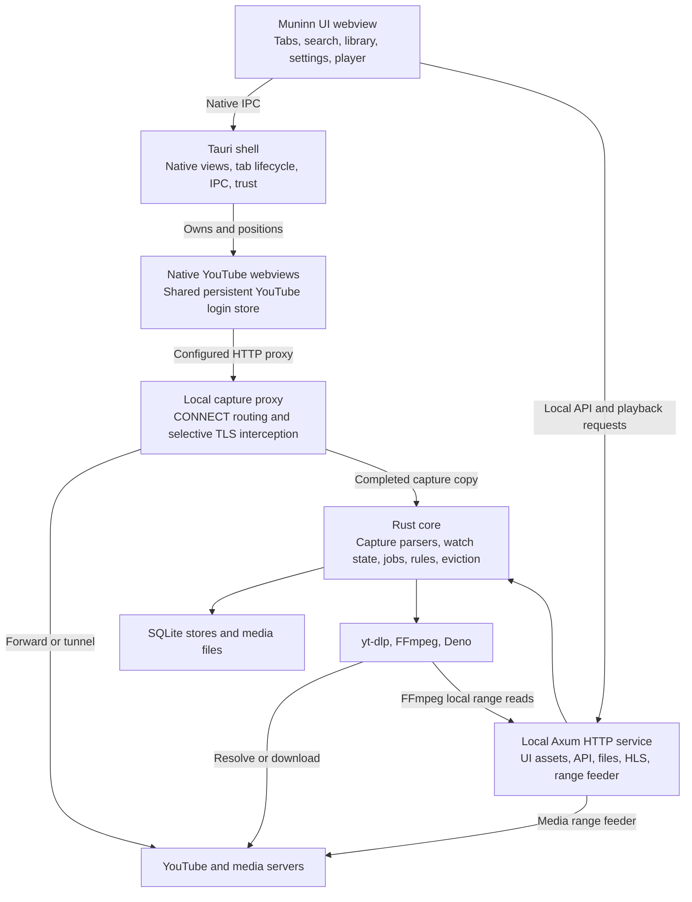
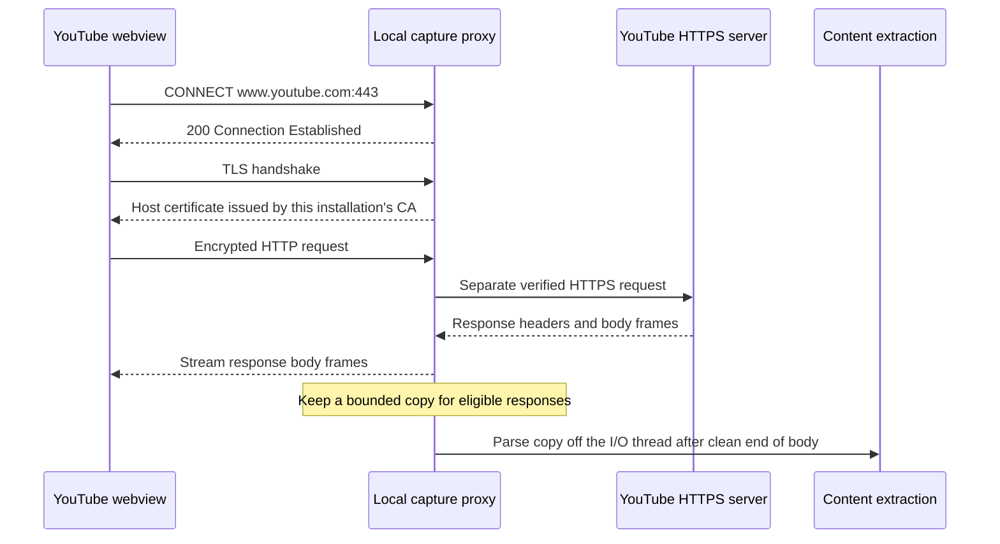

# Muninn architecture

This overview describes the desktop implementation at version **0.2.22**. Muninn
combines a native YouTube browser, a local content library and its own video
player. The Rust service runs **inside the desktop app**. WebKit and the bundled
media helpers can run in separate processes; a separate Muninn server deployment
is not required.

The central architectural distinction is between **capturing browser content**
and **fetching media for playback**. They use separate network paths. The browser
capture proxy collects feeds and metadata; the playback pipeline downloads video
and audio through its own clients and exposes local playback URLs.

## Components

| Component | Responsibility | Main source |
| --- | --- | --- |
| UI | Plain HTML/JS/CSS, including the local player and universal search; embedded in the binary | [`ui/`](../ui/), [`ui_assets.rs`](../core/src/ui_assets.rs) |
| Tauri shell | Native windows/webviews, tab activation and hibernation, menus, video handoff and certificate trust | [`main.rs`](../src-tauri/src/main.rs), [`shell.rs`](../src-tauri/src/shell.rs), [`commands.rs`](../src-tauri/src/commands.rs) |
| Local service | Serves the UI, authenticated control API, thumbnails, local media and streaming endpoints | [`server.rs`](../core/src/server.rs) |
| Capture proxy | Routes browser connections, terminates selected TLS connections and copies eligible responses | [`proxy.rs`](../core/src/proxy.rs), [`ca.rs`](../core/src/ca.rs) |
| Content extraction | Classifies YouTube responses and stores feeds, metadata, recommendations and comments | [`capture.rs`](../core/src/capture.rs), [`extract.rs`](../core/src/extract.rs), [`ingest.rs`](../core/src/ingest.rs) |
| Media pipeline | Cache-first watch state, play while caching, downloads and local compatibility playback | [`watch.rs`](../core/src/watch.rs), [`stream.rs`](../core/src/stream.rs), [`jobs.rs`](../core/src/jobs.rs), [`local_playback.rs`](../core/src/local_playback.rs) |
| Policy and persistence | Settings, rules, subscriptions, organization, retention and eviction | [`engine.rs`](../core/src/engine.rs), [`settings.rs`](../core/src/settings.rs), [`rules.rs`](../core/src/rules.rs), [`eviction.rs`](../core/src/eviction.rs) |

The same core library also supports the headless `muninn-service` binary. The
desktop app additionally supplies native browser, cookie-store and UI hooks.

## The two local listeners

These are separate servers with different responsibilities:

| Listener | Address | Purpose |
| --- | --- | --- |
| App HTTP service | `127.0.0.1:47871` by default; falls back to a free port | `/ui/`, `/api/…`, `/media/…`, thumbnails, HLS and media range feeding |
| Browser capture proxy | `127.0.0.1:<random free port>` | Explicit HTTP CONNECT proxy configured on YouTube webviews |

`Service::start` opens the stores, starts workers and the HTTP service, then
starts the proxy. The shell obtains their actual addresses from the service.
If the capture proxy is unavailable, the shell refuses to create a normal
YouTube tab rather than opening an unproxied browsing view.

The HTTP service generates a fresh authentication token each launch. Protected
API and media routes validate that token; HLS and feeder routes carry it in the
path so relative playlist requests work. Static UI assets and `/health` are
outside the protected API group. The outer middleware rejects non-loopback Host
values. This API token is separate from YouTube authentication.

## Browser proxy: connection routing

Each live YouTube tab is a native webview with a Safari user agent and an explicit
`proxy_url`. On macOS, the webviews share a dedicated persistent YouTube data
store, separate from the UI's browser storage. The separate sign-in window uses
the same store and proxy configuration.

For HTTPS, the browser first sends `CONNECT host:port` to the local proxy. The
proxy normalizes the hostname and applies this policy, in order:

| Destination | Action | What Muninn can inspect |
| --- | --- | --- |
| `googlevideo.com` and its subdomains | Refuse CONNECT with HTTP 403 | Destination hostname; no upstream media connection is opened |
| `accounts.youtube.com` and its subdomains | Open a plain TCP tunnel | Destination and connection metadata; TLS payload stays encrypted |
| `youtube.com` and its other subdomains | Terminate browser TLS, then make a separate HTTPS request upstream | Decrypted HTTP requests and responses |
| Everything else, including `accounts.google.com`, `ytimg.com`, image/font hosts and third-party hosts | Open a plain TCP tunnel | Destination and connection metadata; TLS payload stays encrypted |

Hostname matching respects domain boundaries: `youtube.com.example.org` is not
treated as YouTube. Other plain HTTP proxy requests are refused, except requests
to loopback hosts, which are forwarded. This allows access to the local app
service; the forwarding rule is not restricted to that service's port.

The proxy is configured for Muninn's webviews. The app does not configure it as a
system-wide proxy or VPN. It is also not a general ad-blocking proxy: the page
script hides known sponsored-card containers, and extraction excludes their
video renderers from newly captured feeds.

### TLS interception and trust

For an intercepted host, there are **two TLS connections**:

On first use, Muninn generates a per-install certificate authority in its data
directory. Its private key is user-readable only. The CA has DNS name constraints
for `youtube.com` and `ytimg.com`; the **current routing policy intercepts only
the YouTube hosts in the table**. Allowing `ytimg.com` in the certificate does not
mean its traffic is currently decrypted. Host certificates are cached in memory
and issued with 30-day validity.

On macOS, a WebKit navigation-delegate hook accepts YouTube server-trust
challenges only when the chain validates against Muninn's CA as the sole trust
anchor. If WebKit's proxied subresources still reject the certificate, the app
can install the CA in the user's login keychain with SSL-only, user-scope trust;
macOS asks for confirmation. That fallback extends beyond a single webview and
should not be described as purely app-local trust. Linux development uses
WebKitGTK approval of the exact leaf certificate for each host.

The proxy's upstream TLS client validates YouTube against WebPKI roots. It does
not disable upstream certificate validation. Both intercepted browser HTTP and
the proxy's upstream HTTP client use HTTP/1.1. The proxy removes hop-by-hop
headers and upstream `Alt-Svc` advertisements.

### Which responses are captured

Interception and capture are different steps. A YouTube JavaScript or image
response can pass through the decrypted connection without being copied into
the content cache.

The capture candidates are POSTs under `/youtubei/v1/` and GETs whose Accept
header asks for HTML. Copying is restricted to successful HTTP 200 responses
with JSON or HTML content types. For candidates, the proxy requests gzip and
passes the response's bytes and encoding through to the browser.

The response body is streamed while a `TeeBody` accumulates a copy of at most
**24 MiB**. Overflow discards the copy while forwarding continues. After a clean
end of body, parsing runs on a separate thread; the browser does not wait for
parsing or database writes. There is still copying overhead, and API POST bodies
are collected before forwarding with a **2 MiB** request limit. This is not a
claim of zero buffering or zero latency. Gzip decoding for capture has a 64 MiB
output bound; unsupported encodings or parsing failures are reported without
turning an otherwise valid page response into an error.

`Core::capture` handles `browse`, `search`, `next`, `player`, and initial data
embedded in page HTML. It extracts structured snapshots, channel discoveries,
video metadata, related videos and comments. Continuation responses can extend
existing content. The proxy does not implement a generic HTTP cache that replays
YouTube pages from stored response bodies.

## Playback uses a separate media path

The injected [`inject.js`](../src-tauri/inject.js) handles video links and SPA
navigation, reports page state, and suppresses sponsored cards. The shell also
catches full navigations to video URLs. Video handoff switches the tab into
Muninn's watch view; the YouTube webview is hidden. Network capture belongs to
the proxy, rather than patched page `fetch` or XHR methods.

The watch flow is:

1. `POST /api/watch/{video_id}` checks for a complete local copy first. Existing
   media is served through `/media/{entry_id}` with HTTP range support. Local
   compatibility playback can remux or transcode an unsupported copy to HLS
   without downloading it again or replacing the original.
2. If media is missing, yt-dlp resolves video/audio sources. Deno supports the
   bundled extractor's JavaScript needs. These helpers are not configured to use
   the browser capture proxy.
3. For play while caching, FFmpeg reads from the local `/s/…` range feeder.
   That feeder fetches upstream source bytes in **8 MiB ranges** using the
   resolved URLs and headers. It is a second kind of proxying, specifically for
   media, with no browser TLS interception.
4. FFmpeg writes fragmented-MP4 HLS for startup playback and a final MP4 cache
   file in the same pipeline. The player reads playlists and segments through
   local `/h/…` URLs; once the file is complete, later playback uses that file.

Consequently, blocking browser requests to `googlevideo.com` does not block
Muninn's media downloader: that downloader has its own HTTP path. The proxy's
`media_bytes_fetched` counter concerns the browser capture proxy, not the app's
total downloaded video bytes.

Watch metadata can also be fetched directly by the Rust code in
[`innertube.rs`](../core/src/innertube.rs) when missing from the content cache.
That path uses HTTPS and consent cookies; it is separate from authenticated
yt-dlp helpers and does not automatically inherit the browser login.

## Login and the downloader

Google sign-in traffic to the tunneled account hosts remains encrypted through
the proxy. Subsequent requests to intercepted YouTube hosts are decrypted and
can include YouTube session cookies; tunneling account hosts does not make all
authenticated YouTube traffic opaque.

To authenticate yt-dlp, the desktop app separately reads secure and HttpOnly
YouTube cookies through native WebKit APIs at the start of each helper operation.
It supplies a private, per-operation temporary Netscape cookie file. Cookie
values do not travel through page IPC or enter settings or diagnostics. A failed
native read fails the operation instead of silently falling back to anonymous
access. Normal cleanup removes the file; a process crash can leave it behind.

This handoff explains why being signed in to Browse alone was insufficient in
older versions: the helper needed an explicit session transfer. A successful
login also does not guarantee a particular video's permissions or extractor
compatibility. See [Signed-in downloads](YOUTUBE-SESSION.md).

## Storage, local search and offline behavior

Under the app data directory, the core separates three SQLite stores:

| Store | Purpose |
| --- | --- |
| `db/video.sqlite` | Media entries and job lifecycle; settings and policy/organization data |
| `db/content.sqlite` | Compressed content JSON, metadata/comments with TTLs and feed snapshots |
| `db/browsing.sqlite` | Tab state, URLs, history and restoration information |

Evictable media lives under `cache/video/`; promoted library media lives under
`library/` and is excluded from automatic cache eviction. Durable library links
can exist without downloaded media. **Saved** therefore differs from
**Downloaded**: a disposable cached copy is Not saved, while a saved link may
have no local media. Rules, subscription polling and disk/free-space limits
control background downloads independently of browsing capture.

Universal search reads open tabs and local library/channel APIs. Typing does not
start a remote search. Enter explicitly posts to authenticated `/api/search`
for Videos, Live streams and Channels, displaying online results above local
ones. The Rust search helper uses bounded, flat yt-dlp extraction with the same
per-operation browser cookie handoff; it does not download media or use the
browser capture proxy. It limits results to 12 per type, helper output to 2 MiB,
concurrent helpers to three and each request to 35 seconds including queue time.
Offline mode cancels this work. See [`search.rs`](../core/src/search.rs) and
[Search and tabs](SEARCH-AND-TABS.md).

Hibernation destroys idle native views while retaining enough state to restore
them. Cached feeds can provide a local restore view, but are not a complete
offline implementation of the YouTube website.

Offline mode blocks new proxy CONNECTs and intercepted requests, closes existing
tunnels, prevents new remote core operations and cancels running download work.
Cached content and local playback remain available. Cancellation is coordinated
by the application; it is not an operating-system firewall or a guarantee that
every in-flight network byte stops instantaneously.

## Boundaries and troubleshooting

The capture proxy itself has no bearer-token authentication. Its loopback binding
limits network exposure, but is not isolation from other processes on the same
machine. Its general tunnel branch also forwards non-YouTube HTTPS destinations.
The control API's token protections must not be assumed to cover that listener.

Remote YouTube pages receive a narrow Tauri capability for page-state reports and
video handoff, plus the E2E-result permission; they do not receive the chrome
UI's general control capability. Browser data, cached content and diagnostic
URLs can still be sensitive local data. The architecture does not provide
browsing anonymity or a remote proxy service.

| Symptom | Relevant boundary |
| --- | --- |
| Browsing fails with certificate errors | Browser → capture proxy TLS; inspect trust state and `tls_untrusted`/`tls_failures` |
| Page loads but feeds do not appear locally | Response eligibility, copy limits, encoding, extraction schema or content persistence |
| Browse is signed in but a download fails | Native cookie read → per-helper cookie file → yt-dlp; separate from browser TLS trust |
| Metadata is visible but playback fails | Resolver, upstream media ranges, FFmpeg or local HLS; metadata capture alone does not prove media readiness |
| Browser video requests return 403 | Expected capture-proxy block for `googlevideo.com`; video should be handed to Muninn's player |

Authenticated `/api/proxy` and `/api/captures` expose proxy counters/events and
capture results. They help distinguish successful TLS handshakes, eligible
captures, parse failures and blocked browser media traffic.

The focused tests in [`proxy/tests.rs`](../core/src/proxy/tests.rs) exercise real
CONNECT/TLS against synthetic upstreams, streaming capture, blocked media hosts,
opaque sign-in tunnels, rejected certificates and loopback forwarding. Capture,
session and media tests cover their respective boundaries. Hosted macOS checks
add native WebKit, signing, updater and UI coverage. Synthetic tests do not prove
that every live YouTube response or account-specific video remains compatible.
